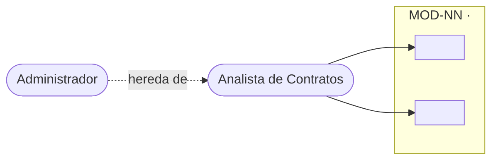
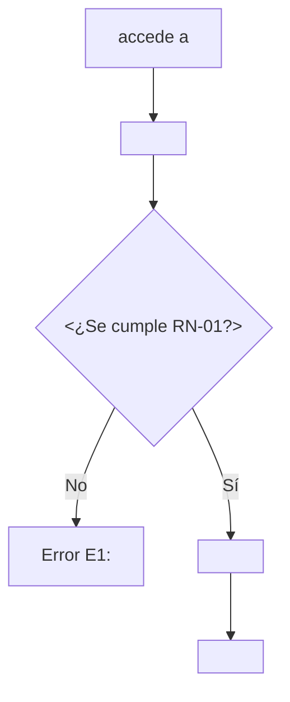

# Plantillas de páginas

> Copia la plantilla que corresponda y rellénala. Reglas comunes:
> - Ningún marcador `<...>` puede quedar sin resolver: se reemplaza por contenido, por `[PENDIENTE: ...]` o se borra la sección si no aplica (con motivo).
> - Texto sin etiqueta = con fuente (código o humano). Lo demás lleva `[PENDIENTE]`, `[POR CONFIRMAR]` o `[Inferencia]`.
> - Toda página nace con `draft: true`. Solo el Revisor lo cambia.
> - `NN` = número con dos dígitos (`MOD-01`, `FUNC-MOD01-01`). `<slug>` = minúsculas, sin tildes, con guiones.
> - Enlaces dentro de una instancia: relativos al archivo y con `.md`. Entre instancias: `/<routeBasePath>/...` según `config-docs.md`.
> - Las plantillas de este archivo son ejemplos de forma, no contenido del sistema.

---

## 1. Frontmatter y `_category_.json`

Página común:
```yaml
---
title: <ID> · <Nombre>
draft: true
---
```
Módulo: añade `modulo_id: MOD-NN`. Funcionalidad (especificación y guía): añade `modulo_id: MOD-NN` y `funcionalidad_id: FUNC-MODNN-NN`. Revisada: `draft: false` y `revisada: AAAA-MM-DD` (solo el Revisor).

`_category_.json` de las carpetas de primer nivel (con `position` para fijar el orden):
```json
{ "label": "<Etiqueta>", "position": <n> }
```
| Instancia | Carpeta | `label` | `position` |
|---|---|---|---|
| `docs-tecnica` | `actores` | Actores | 2 |
| | `modulos` | Módulos | 3 |
| | `especificaciones` | Especificaciones | 4 |
| | `permisos` | Permisos | 5 |
| `docs-usuario` | `guias` | Guías de uso | 2 |

`_category_.json` de cada `MOD-NN-<slug>/` (sin `position`; ordena el nombre de carpeta):
```json
{ "label": "MOD-NN · <Nombre del módulo>" }
```

---

## 2. `intro.md` y `actores-del-sistema.md`

`docs-tecnica/intro.md`
```markdown
---
title: Visión General del Sistema
sidebar_position: 1
draft: true
---

# Visión General del Sistema

<qué es el sistema, para qué sirve y cómo se relacionan sus módulos; o [PENDIENTE: ...]>

## Módulos documentados
| ID | Módulo | Definición |
|---|---|---|
| MOD-NN | [<Nombre>](./modulos/MOD-NN-<slug>/index.md) | <una frase> |
```

`docs-usuario/intro.md`
```markdown
---
title: Bienvenido
sidebar_position: 1
draft: true
---

# Bienvenido

<descripción del sistema en lenguaje no técnico, para el usuario final; o [PENDIENTE: ...]>

## Guías disponibles
- [<Cómo hacer X>](./guias/MOD-NN-<slug>/FUNC-MODNN-NN-<slug>.md)
```

`docs-tecnica/actores/actores-del-sistema.md`
```markdown
---
title: Actores del Sistema
draft: true
---

# Actores del Sistema

| ActorID | Nombre | Definición | Hereda de |
|---|---|---|---|
| ACT-NN | <Nombre> | <qué es y qué responsabilidad tiene> | — / <ACT-NN> |
```

---

## 3. Módulo: `docs-tecnica/modulos/MOD-NN-<slug>/index.md`

```markdown
---
title: MOD-NN · <Nombre del módulo>
modulo_id: MOD-NN
draft: true
---

# MOD-NN · <Nombre del módulo>

**Definición:** <una o dos frases>

## Actores
| ActorID | Actor | Rol en el módulo |
|---|---|---|
| ACT-NN | <Nombre> | <qué hace aquí> |

## Diagrama de Casos de Uso
<patrón de §9>

## Funcionalidades
| ID | Nombre | Propósito | Especificación | Guía |
|---|---|---|---|---|
| FUNC-MODNN-NN | <Nombre> | <una frase> | [Ver](../../especificaciones/MOD-NN-<slug>/FUNC-MODNN-NN-<slug>.md) | [Ver](/<routeBasePath-usuario>/guias/MOD-NN-<slug>/FUNC-MODNN-NN-<slug>) |

## Permisos
[Matriz de permisos](../../permisos/PERM-MOD-NN-<slug>.md)
```

---

## 4. Especificación: `docs-tecnica/especificaciones/MOD-NN-<slug>/FUNC-MODNN-NN-<slug>.md`

```markdown
---
title: FUNC-MODNN-NN · <Nombre>
modulo_id: MOD-NN
funcionalidad_id: FUNC-MODNN-NN
draft: true
---

# <Nombre>

**Propósito:** <una frase>
**Actores:** <ACT-NN Nombre>, <ACT-NN Nombre> · **Módulo:** [MOD-NN](../../modulos/MOD-NN-<slug>/index.md) · **Guía de usuario:** [<título>](/<routeBasePath-usuario>/guias/MOD-NN-<slug>/FUNC-MODNN-NN-<slug>)

## Precondiciones
Estado que debe cumplirse **antes** de empezar (no validaciones de lo que se introduce).
- <sesión iniciada / rol con permiso / acceso a la pantalla>

## Datos de entrada
| Campo | Tipo | Obligatorio | Formato o valores | Fuente |
|---|---|---|---|---|
| <Etiqueta literal de pantalla> | <texto/fecha/selector> | Sí/No | <...> | código / humano |

## Diagrama de Actividad
<patrón de §9; cada error del diagrama es un `En` de la tabla de abajo>

## Reglas de negocio
| ID | Regla | Si no se cumple |
|---|---|---|
| RN-01 | <regla, con valores concretos> | E1 |

## Mensajes de error
| ID | Condición | Campo | Mensaje | Fuente |
|---|---|---|---|---|
| E1 | <cuándo ocurre> | <campo o General> | <texto literal> | código / confirmado por el humano / ejemplo `[POR CONFIRMAR]` |

## Postcondiciones
- <qué queda guardado y en qué estado>

## Fuentes
- `progress/explore_<tema>.md` · confirmaciones del humano: <fecha y tema>
```
Secciones sin contenido: `No aplica` con el motivo, o `[PENDIENTE: ...]`. No se quedan vacías.

---

## 5. Permisos: `docs-tecnica/permisos/PERM-MOD-NN-<slug>.md`

```markdown
---
title: Permisos · MOD-NN <Nombre del módulo>
modulo_id: MOD-NN
draft: true
---

# Permisos · <Nombre del módulo>

Quién puede ejecutar cada funcionalidad. `✔` = permitido, `✘` = no permitido.

| Funcionalidad | <Actor 1> | <Actor 2> |
|---|---|---|
| [FUNC-MODNN-NN · <Nombre>](../especificaciones/MOD-NN-<slug>/FUNC-MODNN-NN-<slug>.md) | ✔ | ✔ (hereda) |

Los actores que heredan permisos se indican con `(hereda)`; la herencia está definida en [Actores del Sistema](../actores/actores-del-sistema.md).
```
La evidencia de cada celda está en `progress/explore_<tema>.md`, no en la página.

---

## 6. Guía de usuario: `docs-usuario/guias/MOD-NN-<slug>/FUNC-MODNN-NN-<slug>.md`

```markdown
---
title: Cómo <hacer X>
modulo_id: MOD-NN
funcionalidad_id: FUNC-MODNN-NN
draft: true
---

# Cómo <hacer X>

**Quién puede hacerlo:** <Actor 1> y <Actor 2>.

## Antes de empezar
- <lo que el usuario necesita tener a mano, en su lenguaje>

## Pasos
1. <Ve a **Etiqueta literal**.>
2. <Presiona el botón **Etiqueta literal**.>

<aviso de captura, §8>

## Resultado esperado
<qué ve el usuario cuando todo sale bien>

## Si algo sale mal
| Mensaje que ves | Qué significa | Qué hacer |
|---|---|---|
| <texto literal del error> | <explicación sencilla> | <acción> |

## Preguntas frecuentes
**¿<Pregunta?>**
<Respuesta con fuente.>

## Ver también
[Especificación técnica](/<routeBasePath-tecnica>/especificaciones/MOD-NN-<slug>/FUNC-MODNN-NN-<slug>)
```

---

## 7. `docs-usuario/faqs.md`

```markdown
---
title: Preguntas Frecuentes
sidebar_position: 3
draft: true
---

# Preguntas Frecuentes

Preguntas que no pertenecen a una guía concreta. Las de cada funcionalidad están en su guía.

**¿<Pregunta?>**
<Respuesta con fuente.>
```

---

## 8. Aviso de captura pendiente

Las capturas las aporta el humano, con datos de prueba, en `img/` junto a la guía y con nombre `FUNC-MODNN-NN-NN.png`. Mientras no existan:
```markdown
:::caution
**PENDIENTE: captura** de <qué debe mostrar> → `./img/FUNC-MODNN-NN-01.png`
:::
```
Cuando el archivo exista: ``. No se usa `` con ruta vacía.

---

## 9. Patrones de diagramas (Mermaid)

**Casos de uso** (Mermaid no tiene UML de casos de uso nativo: se aproxima con `flowchart`, con frontera y herencia):
````markdown

````
Un actor que hereda no repite las flechas del padre. Solo añade las suyas propias.

**Actividad** (cada rama de error lleva el `En` de la tabla de errores):
````markdown

````

---

## 10. Referencia de configuración de Docusaurus (la hace el humano)

> [No verificado] Escrito de memoria, sin contrastar con la documentación vigente. El harness **no edita** `docusaurus.config.*`; esto es solo para que el humano lo compare con el suyo.

```js
// docusaurus.config.js
module.exports = {
  markdown: { mermaid: true },
  themes: ['@docusaurus/theme-mermaid'],
  presets: [['classic', {
    docs: { path: 'docs-tecnica', routeBasePath: 'tecnica' },  // sin sidebarPath: sidebar autogenerado
  }]],
  plugins: [['@docusaurus/plugin-content-docs', {
    id: 'usuario', path: 'docs-usuario', routeBasePath: 'usuario',
  }]],
};
```
Los `routeBasePath` reales se anotan en `config-docs.md`.

---

## 11. `progress/`

`progress/current.md`
```markdown
# Sesión actual (documentación)
> Estado vivo. Se actualiza mientras se trabaja y se vacía al cerrar la sesión (su resumen pasa a `history.md`).
> No es fuente de verdad: el contenido vive solo en `docs-tecnica/` y `docs-usuario/`.

- **Fase:** —
- **Foco (módulo / funcionalidad):** —
- **Inicio:** —

## Confirmado en esta sesión
| Tema | Lo confirmado (lo más cercano posible a lo dicho) | Quién | Destino |
|---|---|---|---|

## Preguntas abiertas
| # | Pregunta (una línea) | Opciones propuestas | Bloquea |
|---|---|---|---|

## Páginas tocadas
| Archivo | Acción | IDs |
|---|---|---|

## Próximo paso
—
```

`progress/history.md`
```markdown
# Bitácora de documentación (solo se añade al final)
> Al cerrar cada sesión se añade su entrada. No se editan entradas anteriores.
---
```

`progress/explore_<tema>.md` (lo escribe el Explorador)
```markdown
# Exploración: <tema>
- **Pregunta:** <la pregunta recibida>
- **Alcance leído:** <carpetas o archivos>
- **Fecha:** <AAAA-MM-DD>

## Hallazgos
| # | Dato | Valor (literal si es texto de interfaz) | Evidencia (`archivo:línea`) | Confianza |
|---|---|---|---|---|
| 1 | <...> | <...> | <...> | alta / media / baja |

## No encontrado
- <lo que se buscó y no apareció>

## Notas
- Credenciales: no leídas. <hallazgos que parecen defectos o contradicciones, con evidencia>
```

`progress/review_<ID>.md` (lo escribe el Revisor, una sección por ronda)
```markdown
# Revisión: <ID>
## Ronda 1 · <AAAA-MM-DD> · CAMBIOS REQUERIDOS | LISTA
R1 ✔ · R2 ✔ · R3 ✘ · R4 ✔ · R5 ✔ · R6 ✔ · R7 ✔ · R8 ✔
1. [R3] «<cita>» (`<archivo>`): <motivo>. Propuesta: <redacción concreta>.
```
